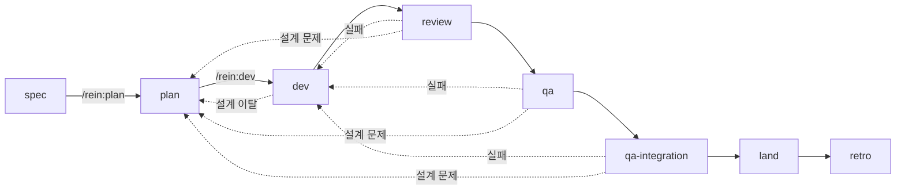

# 개요

Rein은 Claude Code 작업을 정해진 단계로 진행시키는 플러그인입니다.
단계마다 누가 무엇을 쓸 수 있는지 훅이 강제하고, 산출물을 판정해 run을 다음 단계로 옮깁니다.

## 단계

| 단계 | 하는 일 | 문서 |
|---|---|---|
| `spec` | 문제·현행 동작·완료 판정 정리. 채점과 질문 | [1-spec.md](./stages/1-spec.md) |
| `plan` | 설계와 검증 계획. 설계 리뷰 | [2-plan.md](./stages/2-plan.md) |
| `dev` | 설계대로 코드 작성 | [3-dev.md](./stages/3-dev.md) |
| `review` | 설계·룰·정확성 판정 | [4-review.md](./stages/4-review.md) |
| `qa` / `qa-integration` | 검증 명령, e2e, 완료 판정 대조 | [5-qa.md](./stages/5-qa.md) |
| `land` | 승인받고 워크트리에서 커밋해 메인 작업 트리로 가져옴. 회고 | [6-land.md](./stages/6-land.md) |

사람이 멈춰 세우는 곳은 세 곳입니다.

- `1-spec.md` 승인 — `/rein:plan`
- `2-plan.md` 승인 — `/rein:dev`
- 커밋 승인 — land에서 `커밋`

e2e 확인 항목이 있으면 통합 qa 앞에서도 멈춥니다. 사용자가 직접 테스트하거나 `/rein:e2e`로 맡깁니다.
멈춘 run은 새 세션에서 `/rein:<단계> <slug>`로 이어 갈 수 있습니다.

`/rein:autopilot <요청>`으로 연 run은 spec 승인, plan 승인, e2e 실행(Ego), 커밋에서 멈추지 않습니다. 훅이 그 자리에서 메인 세션에 답을 직접 넘기라고 안내하고, 메인 세션은 `said: "autopilot"`으로 넘깁니다. spec 질문, 리뷰를 통과하지 못한 설계, HEAD와 다른 config, 사람만 확인할 수 있는 항목(화면 배치 대조, ego 핸드오프), 판단이 서지 않는 halt에서는 여느 run처럼 사용자를 기다립니다. push는 하지 않습니다.

## 누가 무엇을 하나

- **메인 세션** — 사용자와 대화하며 run을 진행합니다. 도구 제한을 받지 않지만, 판정 파일을 써도 판정으로 치지 않습니다.
- **Rein 서브에이전트** — 설계·코드·판정·커밋을 맡습니다. 프롬프트는 훅이 run 상태로 직접 쓰고, 쓰기·Bash는 역할마다 좁게 허용합니다.
- **훅** — 단계 전이, 산출물 형식 검사, 검증 명령 실행, 기록을 맡습니다.

자세한 것은 [agents.md](./agents.md).

## 워크트리

run마다 자기 git 워크트리에서 작업합니다. 같은 저장소에서 run 여러 개를 병렬로 돌려도 변경이 섞이지 않습니다.

- **위치** — `<저장소>/.claude/worktrees/<slug>`, 브랜치 `rein/<slug>`, 만들 때의 로컬 HEAD 기준. 메인 작업 트리의 커밋 안 된 변경은 들어가지 않습니다. 단, HEAD에 `.rein/config.json`이 없으면 메인 작업 트리의 것을 복사하고, 그 뒤 준비 명령을 실행합니다. `.claude/worktrees/`는 그 저장소의 `.git/info/exclude`에 넣어 `git status`에 나오지 않게 합니다.
- **언제** — plan을 통과할 때 2-plan.md가 지정한 저장소마다 만듭니다. 세션 루트의 저장소도, 그 안에 든 다른 저장소도, 세션 루트 밖 저장소도 같습니다. 세션은 워크트리에 들어가지 않고 메인 작업 트리에 머뭅니다. 세션이 워크트리에 들어가면 Claude Code가 그 밖의 워크트리 쓰기를 막아, 저장소 여러 개를 고치는 run이 막히기 때문입니다.
- **경로** — `2-plan.md` 본문은 원래 경로 그대로 두고, run 기록의 파일 목록만 워크트리 경로로 바꿉니다. dev에 "원래 경로 → 워크트리 경로" 대응표를 줍니다.
- **준비 명령** — `.rein/config.json`의 `worktree.setup`(예: `npm ci`)을 워크트리를 만든 뒤 한 번 실행합니다. 실패해도 run은 진행하고 사용자에게 알립니다.
- **e2e** — 확인할 앱은 워크트리에서 띄워야 합니다. 메인 작업 트리에서 띄운 앱에는 run의 변경이 없습니다. 훅은 앱이 어디서 떠 있는지 알 수 없으므로, 통합 qa에 들어갈 때 이렇게 안내하고 `5-checklist.md` 맨 위에도 적습니다. 주소의 포트를 다른 트리의 앱이 쓰고 있으면, 워크트리 앱을 빈 포트로 띄우고 워크트리 `.rein/config.json`의 주소를 그 포트로 바꿔 승인받습니다.
- **land** — [6-land.md](./stages/6-land.md). `park`의 `폐기`는 워크트리와 브랜치를 지우고, `보류`·`완료`는 남깁니다.
- **이어가기** — 새 세션에서 resume해도 세션은 메인 작업 트리에 머뭅니다. 다른 PC에서 허브 서버를 거쳐 이어받으면 그 PC의 HEAD에서 워크트리를 새로 만듭니다.
- 워크트리 도입 전에 열린 run은 예전처럼 메인 작업 트리에서 진행하고, land는 스테이징까지만 합니다. `open_run`이 세션 루트의 워크트리를 만들던 때 열린 run은 그 워크트리를 그대로 쓰되, 세션은 메인 작업 트리에서 이어갑니다.

## 파일 위치

| 위치 | 내용 |
|---|---|
| `~/.rein/<project>/active/<runId>/` | 진행 중 run의 산출물. 보류는 `defer/`, 완료는 `complete/`, 폐기는 `drop/` |
| `~/.rein/<project>/rules/` | 프로젝트 룰. `paths:` glob으로 적용 대상을 정함. run을 열 때 동결 |
| `~/.rein/rules/` | 공용 룰. 모든 프로젝트의 run이 프로젝트 룰과 함께 동결하고, run이 고치는 모든 저장소에 적용. review에서는 `rules:<이름>`으로 부름 |
| `~/.rein/<project>/knowledge/` | 도메인 지식. 에이전트가 화면·기능의 파일을 찾을 때 먼저 봄 |
| `<repository>/.rein/config.json` | 저장소의 검증 명령 (`qa`, `e2e`)과 워크트리 준비 명령 (`worktree.setup`) |
| `<repository>/.claude/worktrees/<runId>/` | run의 워크트리. land나 `폐기`에서 지움 |
| `~/.claude/plugins/store/rein_*.json` | run 상태 (`$.store`) |

run 폴더 바로 아래에는 사람이 읽거나 쓰는 파일만 둡니다. 읽는 파일은 만들어지는 단계 번호를 앞에 붙여 위쪽에 모입니다. 에이전트와 훅만 읽는 파일은 `agent/`에 모읍니다.

| 단계 | run 폴더 | `agent/` |
|---|---|---|
| spec | `1-spec.md`, `1-mockup.html`, `brief/`(기획서 사본) | `grade.md`, `asis.html`·`tobe.html`(목업의 두 부분, 훅이 합침), `comments.json`(사용자 코멘트), `layout-verify.md`, `layout/`(렌더링한 to-be) |
| plan | `2-plan.md`, `2-plan.html` | `test-plan.md` |
| dev | `handoff/` | `dev-items.md`, `dev-diff.md`(마지막 회차 diff), `fails.md`(회차별 읽은 실패), `deviation.md` |
| review | | `review.md`, `review-groups.md`, `review-<n>.md` |
| qa | `5-checklist.md` | `qa.md`, `qa-output.log`, `e2e.md`, `evidence/`(e2e 확인별 스크린샷·증거) |
| land | `6-land.md`(커밋 메시지, 저장소별 파일 목록) | |
| retro | | `retro.md`, `retro-read/`(reader가 읽은 몫과 메모) |

`agent/`가 생기기 전에 만든 run은 재개할 때 옛 파일을 `agent/`로 복사합니다. 옛 파일은 지우지 않고, 이미 찍은 스크린샷은 원래 자리에 둡니다.

훅의 모든 결정은 run 폴더의 `agent/trace.jsonl`에 남습니다 — [verification.md](./verification.md).

도메인 지식 목록(파일마다 경로와 `description:`)은 `mcp__rein__status`가 `agent/knowledge.md`에 쓰고, status에는 그 경로만 보여 줍니다. 지식이 바뀌면 다음 status가 다시 씁니다.
