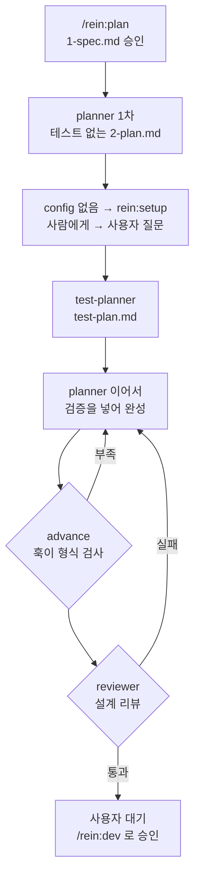

# 2. plan — 설계

승인된 spec을 **어떻게** 풀지 `2-plan.md` 하나로 설계합니다.
메인 세션은 진행만 하고, 설계는 서브에이전트가 합니다.

에이전트 지시: [skills/plan/SKILL.md](../../skills/plan/SKILL.md) · [agents/planner.md](../../agents/planner.md) · [agents/test-planner.md](../../agents/test-planner.md)

## 흐름

1. `/rein:plan` 입력이 `1-spec.md` 승인입니다. `advance(승인)`로 run이 plan에 들어갑니다.
2. `rein:planner`가 설계를 쓰고 답합니다: `설계:`, `config 없음:`, `사람에게:`.
   - `.rein/config.json`이 없는 저장소는 `rein:setup`이 사용자 확인을 받아 만듭니다.
   - 화면·코드의 각 부분(검색영역, 버튼, 그리드, 팝업, 서버 조회·저장·예외 처리 등)은 같은 메뉴(없으면 다른 메뉴)의 선례를 찾아 따르고, 설계 줄에 `선례 path:line`으로 적습니다. 선례가 없거나 갈리면 `사람에게`로 묻습니다.
3. `rein:test-planner`가 검증만 정해 `test-plan.md`에 씁니다 — 파일별 테스트, e2e 확인, 완료 판정 덮기, 변경 전 실패.
4. 같은 planner를 `SendMessage`로 이어 불러 검증을 `2-plan.md`에 넣습니다. 이어 부르는 것은 plan 방문 한 번 안에서만입니다. dev 등에서 plan으로 돌아오면 새 planner를 띄웁니다 — 이전 방문의 조사가 쌓인 planner는 큰 run에서 컨텍스트 68만 토큰까지 찬 일이 있습니다(2026-11-03).
5. `advance` — 훅이 형식을 검사하고, 통과하면 설계 리뷰를 요구합니다.
6. 리뷰 통과 → run은 사용자를 기다립니다. **`/rein:dev`** 입력이 승인입니다.

## 2-plan.md

위쪽(제목 ~ `## 접근 방법`)은 사용자가 승인하려고 읽고, 아래쪽은 worker·reviewer가 읽습니다.

| 섹션 | 언제 | 내용 |
|---|---|---|
| `## 변경 요약` | 항상 | 파일당 한 줄: 종류(수정·새 파일·삭제), 무엇이 어떻게 |
| `## 결정 사항` | 있을 때 | 사용자가 알아야 할 결정. spec의 미해결 질문과 남은 `[?]`마다 근거가 `가정:`인 행 |
| `## 실패한 시도의 전제` | 실패가 설계 문제로 판정돼 돌아온 뒤 | 실패들의 공통 전제와 그 검증 |
| `## 접근 방법` | 항상 | 어떻게 푸는지 몇 문단 |
| `## 상세 설계` | 항상 | `### <파일 경로>`마다 할 일과 `테스트:` 또는 `테스트 면제:`. **이 목록이 dev가 쓸 수 있는 파일 전부**. 있는 파일은 예상 diff를 `diff` 펜스로, hunk마다 `@@ <블록> @@ <바꾸는 이유>` |
| `## 넘길 것` | 있을 때 | 사람이 저장소 밖에서 적용할 파일. dev가 run의 `handoff/`에 씀 |
| `## 영향 범위` | 항상 | spec의 영향 범위 항목마다 `변경` / `테스트: <파일>` / `유지: <이유, path:line>` / `넘김: <파일>` |
| `## e2e 확인` | config에 `e2e`가 있을 때 | 확인 항목마다 `앱`, `할 일`, `기대`, `저장`, (선택) `계정`, `파일` |
| `## 배치 대조` | `1-mockup.html`에 to-be가 있을 때 | to-be 화면마다 `페이지`, `경로`, `볼 곳` |
| `## 완료 판정 덮기` | 항상 | 완료 판정 줄의 부분마다 `e2e: <확인>` / `테스트: <파일>` / `확인 불가: <이유>` |
| `## 변경 전 실패` | 있을 때 | 변경 전 코드에서 실패해야 할 단언. review가 확인 |

## 2-plan.html

리뷰를 통과해 사용자를 기다릴 때 훅이 `2-plan.md` 옆에 씁니다. 브라우저로 열면 파일마다 지금 코드(as-is)와 `## 상세 설계`의 diff를 적용한 코드(to-be)를 Monaco diff 편집기로 나란히 보여 줍니다.

- 변경만 보기와 전체 보기, 나란히 보기와 한 칸 보기를 바꿀 수 있습니다.
- 커서를 둔 hunk의 이유(`@@ … @@` 뒤 문장)가 오른쪽 패널에 나옵니다. 패널 폭은 경계선을 끌어 바꿉니다.
- hunk는 발췌라서 그대로 두는 줄과 `-`줄을 순서대로 찾되 사이에 다른 줄이 있어도 됩니다. 찾지 못한 hunk는 「미적용」으로 표시만 하고, 승인을 막지는 않습니다.
- 바뀌는 파일의 전체 내용이 들어가며, run의 다른 파일처럼 로컬 frame 서버가 허브 서버에도 올립니다.
- Monaco는 cdnjs에서 받습니다(버전 고정이라 처음 한 번 받고 나면 브라우저 캐시에서 읽음).

## 훅의 형식 검사 (advance)

- 필수 섹션이 있고, 상세 설계 항목마다 테스트 또는 면제가 있다
- 설계의 모든 파일이 git 저장소 안에 있다
- 그 저장소마다 쓸 수 있는 `.rein/config.json`이 있다
- `## e2e 확인`의 앱이 config의 `e2e.apps`에 있다
- `## 완료 판정 덮기`가 완료 판정 줄의 부분을 덮고, 테스트 파일이 설계 항목이거나 이미 있는 파일이다
- `## 배치 대조`가 `1-mockup.html`의 to-be 화면과 하나씩 맞는다

세션 루트 밖 저장소가 처음 나오면 그 프로젝트의 룰을 동결하고 한 번 멈춥니다. 설계가 그 룰을 따르게 하기 위해서입니다.

## 설계 리뷰

`rein:reviewer`가 코드 작성 전에 설계를 읽고 `mcp__rein__plan_review`로 판정합니다.

- **룰** — 설계 파일에 걸리는 룰마다 지키는지
- **영향 범위** — spec의 항목마다 답이 있고, `유지`의 `path:line`이 실제로 그 이유를 보여 주는지
- **spec 대조** — spec의 요구마다 그것을 수행하는 설계 항목이 있는지. 미해결 질문과 다른 절에 남은 `[?]`마다 `가정:` 행이 있고 설계가 그 가정을 따르는지. spec의 `## 결정 트리`는 질문 기록이라 요구로 보지 않고, 결정은 다른 절에서 봅니다

실패하면 사유를 planner에게 넘겨 고친 뒤 다시 리뷰합니다.
한 번의 plan 방문에서 두 번 실패하면 훅은 더 요구하지 않고, 사용자가 진행 여부를 정합니다.

설계가 한 번 승인된 뒤 plan으로 돌아오면, 리뷰는 승인된 `2-plan.md`와 지금의 차이만 봅니다.
훅이 바뀐 줄을 task에 넣고, reviewer는 바뀐 부분과 그것이 바로 닿는 곳(바뀐 항목이 맡던 spec 요구, 바뀐 `## 영향 범위` 답, 바뀐 설계에 걸리는 룰)만 판정합니다. 바뀌지 않은 부분은 이미 통과했으므로 그것으로 실패시키지 않습니다.
그 방문의 두 번째 리뷰도 승인된 설계와의 차이를 봅니다.
그 사이 `1-spec.md`가 다시 승인됐으면 설계 전체를 리뷰합니다.

## plan으로 돌아오는 경우

| 원인 | 비고 |
|---|---|
| 중재자가 설계 이탈을 `합당`으로 판정 | dev에서 |
| review·qa·통합 qa 실패가 설계 문제로 판정됨 (reviewer·triage의 `## 실패 원인`, `failure-route` 멈춤에서 메인 세션, 또는 사용자의 `plan으로 보냄`) | `failFile`에 그 실패 |
| land에서 사용자가 `되돌림` | |
| 커밋할 변경이 없음 | 사용자가 plan을 고름 |
| `1-spec.md`에 완료 판정 줄이 없음 | |

돌아오면 같은 흐름을 다시 밟습니다.
설계가 한 번 승인된 뒤라면(그 사이 `1-spec.md`가 다시 승인되지 않았으면) 처음부터 다시 쓰지 않습니다.
훅이 planner와 test-planner의 task에 그 사실을 넣고, test-planner에게는 승인된 `2-plan.md`와 지금의 차이도 넣습니다.
planner는 지금의 `2-plan.md`에서 요청된 변경에 필요한 항목만 `Edit`하고 `테스트:` 줄과 검증 절은 그대로 둡니다.
test-planner는 그 변경이 닿는 테스트·e2e 확인·완료 판정 덮기 줄만 고치고 `바꾼 것:`으로 알리며, planner는 그것만 옮깁니다.
글자가 그대로인 e2e 확인은 이전 통과가 유지됩니다.
test-planner는 매번 부릅니다 — 변경이 검증에 닿는지는 그가 판단하고, 닿지 않으면 아무것도 바꾸지 않습니다.
승인된 `2-plan.md`도 동결됩니다. 바뀌면 훅이 알리고, 판정을 다시 받으려면 `goto`로 옮깁니다.
