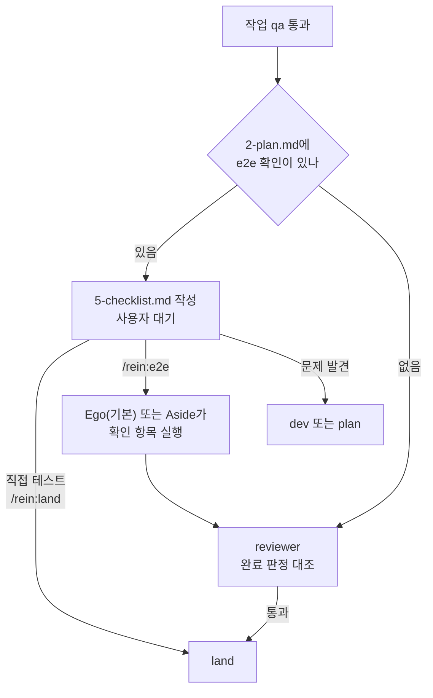

# 5. qa

두 층입니다. 둘 다 코드를 고치지 않습니다 — 코드 문제는 dev로 돌려보냅니다.

| 단계 | 누가 돌리나 | 보는 것 | 파일 |
|---|---|---|---|
| `qa` (작업 qa) | 훅이 config의 `qa` 명령 실행 | 종료 코드 | `qa.md`, `qa-output.log` |
| `qa-integration` (통합 qa) | 사람 또는 브라우저 에이전트 | 체크리스트, 완료 판정 줄 | `5-checklist.md`, `e2e.md` |

에이전트 지시: [skills/qa/SKILL.md](../../skills/qa/SKILL.md) · [skills/e2e/SKILL.md](../../skills/e2e/SKILL.md) · [agents/triage.md](../../agents/triage.md) · [agents/impact.md](../../agents/impact.md)

## 작업 qa

`advance`를 부르면 **훅이** 바뀐 저장소마다 `.rein/config.json`의 `qa` 명령을 모두 돌립니다. 에이전트는 돌리지 않습니다.

- **모두 통과** → 훅이 `qa.md`를 쓰고 통합 qa로.
- **실패** → qa에 머묾. 전체 출력은 `qa-output.log`.
  `rein:triage`가 로그와 코드를 읽고 가립니다.
  - **코드 탓** → `qa.md`에 `## 실패 원인`(구현·설계)을 씀 → 그대로 dev 또는 plan
  - **환경 탓** (JDK 버전, DB·Docker 미기동, 네트워크 등) → 사용자에게 알림. 고친 뒤 `다시 돌림`
- 명령 실행 중 `.rein/config.json`이 바뀌면 실패로 봅니다. 판정할 에이전트가 없어 run을 멈추고(`failure-route`) 메인 세션이 dev·plan을 고릅니다. 코드가 자기 검사를 바꾼 것이기 때문입니다.
- plan 통과 후 config가 바뀌었으면 돌리기 전에 `새 config 승인` / `그대로`를 묻습니다.
- config의 `precheck`(컴파일·타입 검사)는 review 전에 이미 돌아 통과한 것입니다([4-review.md](./4-review.md#기계-검사-precheck)). qa는 그와 상관없이 `qa` 명령을 모두 돌립니다. 테스트처럼 오래 걸리는 검사는 `qa`에만 둡니다.

## 통합 qa

### 사용자 대기 (`e2e: wait`)

e2e 확인 항목이 있으면 아무것도 자동으로 돌지 않습니다. 훅이 `5-checklist.md`를 쓰고 멈춥니다.
페이지별로 접근 메뉴, 할 일, 기대 결과, 로그인 계정이 적힌 체크리스트입니다.
프레임은 이 파일을 카드로 그립니다. 제목 옆에 체크한 칸 수가, 아래에 항목마다 한 칸씩인 진행 막대가 있습니다. 화면(`##`)마다 카드 하나에 그 화면의 칸 수를 붙이고, 항목마다 할 일과 기대를 나란히 놓고 그 항목의 칸 수(`n / m`)를 붙입니다. 칸을 누르면 파일에 바로 씁니다.

사용자가 고르는 길:

- **직접 테스트** — 모든 칸을 `- [x]`로 체크하고 `/rein:land`
- **`/rein:e2e`** — 묻지 않고 Ego로 돌림. Aside는 `/rein:e2e aside`처럼 사용자가 말할 때만. 사용자가 이미 체크한 항목은 돌리지 않습니다
- **문제 발견** — 메인 세션이 `## 찾은 문제`에 적고 `dev로 보냄` 또는 `plan으로 보냄`

### e2e 실행

| 경로 | 동작 |
|---|---|
| Aside | 확인 항목마다 `rein:e2e-runner` 하나가 aside를 돌리고 결과 파일을 씀. 동시 5개까지 |
| Ego | `rein:ego-driver`가 ego 브라우저에서 항목을 돌리며 증거를 남기고, `rein:ego-judge`가 증거만 보고 판정. `대조`가 아닌 항목은 `레이아웃`도 판정 |
| 없음 | 돌릴 것 없음. 완료 판정 대조로 바로 |

- 같은 앱·같은 계정이고 저장하지 않는 항목만 동시에 돕니다. 저장하는 항목은 판정이 날 때까지 다른 항목을 기다리게 합니다(증거 부족으로 드라이버가 다시 저장할 수 있어서).
- Ego에서 driver가 끝낸 항목은 판정이 날 때까지 그 프로필의 계정을 쥡니다. judge가 증거 부족으로 driver를 다시 보낼 수 있어서, 그 사이 같은 프로필에서 다른 계정 항목은 시작하지 않습니다.
- 증거 부족으로 다시 판정할 때 judge는 첫 판정을 넘겨받아, 통과한 부분은 새 증거가 반대를 보이지 않는 한 그대로 두고 증거 부족이었던 부분만 다시 판정합니다.
- 운영 URL·운영 백엔드면 돌리지 않고 멈춥니다. 앱이 응답하지 않거나 시간이 지나도 멈춥니다.
- 시작 전에 메인 에이전트가 config `backends`의 호스트가 응답하는지 확인하고, 꺼진 것이 있으면 사용자가 띄울 때까지 기다립니다.
- 워크트리 run이면 시작 전에 run을 시작한 브랜치에 그 뒤로 같은 파일을 바꾼 커밋이 들어왔는지도 확인합니다. 있으면 land의 cherry-pick이 충돌하므로, 사용자 동의를 받아 워크트리를 그 브랜치 위로 rebase해 충돌을 풀고 `goto`로 review로 돌아갑니다. e2e는 합친 코드로 한 번만 돕니다.
- Ego는 로그인·2단계 인증·캡차를 사용자에게 넘길 수 있습니다.
- Ego driver의 Bash는 라운드(`ego-browser nodejs < <폴더>/round-NN.mjs`)와 읽기 전용 명령(cat·head·tail·grep·`sed -n` 등, 서로 파이프 가능)만 돕니다. 쓰기·리다이렉트·`cd`·`sleep`은 거부되고, 거부 메시지가 대신할 방법(다음 라운드 파일, Glob·Grep·Read, 라운드 코드 안의 `new Date()`·`page.waitForTimeout(ms)`)을 알려 줍니다.
- 하네스가 스페이스나 라운드 중 새 창을 여는 중 ego가 응답하지 않으면(`CdpRequestTimeoutError`) driver의 코드 오류로 보지 않습니다. 저장하지 않는 항목은 같은 round를 한 번 다시 돌리고, 또 실패하거나 저장하는 항목이면 새 공간에서 처음부터 다시 합니다. 새 창에서 그랬다면 저장하는 항목은 이미 저장한 뒤일 수 있기 때문입니다. 새 공간은 스페이스를 잃은 것처럼 다룹니다: 훅이 스페이스를 닫고 새 시도를 한 번 열며, 그 뒤에 또 잃으면 판정 없이 항목을 닫습니다.
- 다른 run이나 사람의 손 테스트가 같은 데이터를 바꿀 수 있어서, Ego에서 `데이터 조건`이 있는 항목은 driver가 데이터를 스스로 확보합니다.
  - driver는 할 일의 데이터가 조건에 맞는지 MCP 도구(DB 등)와 화면으로 확인합니다. MCP 도구로는 조회만 합니다. 훅이 driver의 MCP 호출을 입력·결과째 항목 폴더의 `mcp-NN.json`으로 남깁니다.
  - 맞지 않으면 조건에 맞는 다른 데이터로 바꿉니다. 그런 데이터가 없으면 화면에서 `E2E`와 월일시분초 표시를 넣어 만들고, 확인이 끝나면 되돌립니다. 바꿀 수 있는 것은 데이터와 그 데이터에 닿는 단계뿐이고, 페이지·기대·구분·계정은 바꾸지 않습니다.
  - judge는 기대보다 먼저 `judge.md`의 `## 데이터`에 조건마다 맞음·안 맞음과 실제로 쓴 데이터(`데이터:`)를 씁니다. 안 맞는 조건에 기대는 기대 줄은 증거 부족이 되어 driver에게 돌아갑니다. 기대 줄이 모두 통과하면 항목은 통과하고, 안 맞은 조건은 judge.md에 기록만 남습니다.
  - 만들 수도 없으면 judge가 `데이터 없음`으로 판정합니다. 실패로 세어 `D173`으로 멈추고, 질문에 데이터 없음으로 표시합니다. 사용자는 데이터를 준비한 뒤 `실패 항목만 다시 돌리기`를 고릅니다.
  - 통과한 항목은 `5-checklist.md`의 칸 체크 이유에 `사용한 데이터:`가 붙습니다. 체크리스트에는 항목마다 데이터 조건도 적혀, 손으로 확인하는 사람도 데이터가 바뀌었으면 맞는 데이터로 바꿔 확인합니다.
- Ego에서 화면을 바꾸는 항목(`대조`가 아닌 항목)은 driver가 스크린샷과 함께 select·input·그리드의 크기와 위치를 재고, judge가 기대와 별도로 `레이아웃`을 판정합니다. 가장 긴 내용보다 60px 넘게 넓은 select·input, 컨테이너를 채우지 않거나 넘치는 그리드 컬럼, 같은 줄·열에서 3px 넘게 어긋난 필드는 실패입니다. 판정은 기대가 화면에 새로 생기거나 바뀐다고 한 요소만 봅니다. 할 일에서 누르거나 채우기만 한 요소와 다른 요소의 결함은 적기만 합니다. 기대가 인쇄물·다운로드 파일만 다루는 항목은 화면이 바뀐 것이 아니므로 레이아웃을 통과로 둡니다. `대조` 항목은 화면이 바뀌지 않으므로 기존 결함으로 실패하지 않게 레이아웃을 보지 않습니다.
- 결과는 훅이 `e2e.md`의 `## e2e`로 모읍니다.
- dev로 돌아갔다 와도 이전에 통과한 항목은 통과가 유지됩니다. 기준은 항목이 걸린 파일입니다(`파일:`에 적힌 파일, 없으면 설계 파일 전부).
  - 걸린 파일이 안 바뀌었으면 그대로 유지합니다.
  - 바뀌었으면 작업 qa 통과 직후, 체크리스트를 쓰기 전에 `rein:impact`가 판정합니다. 통과 당시 사본(`agent/sealed/`)과 지금 파일의 diff(`agent/impact-diff.md`)를 보고, 항목마다 영향이 있는지 `agent/impact.md`에 씁니다. 영향 없는 항목은 체크된 채로 나오고 다시 돌지 않습니다.
  - 유지된 항목도 사용자가 체크를 풀면 `/rein:e2e` 때 다시 돕니다.
  - plan을 다시 통과해도 설계가 그 항목을 글자 그대로 두면 유지됩니다. `## 배치 대조` 항목(`배치-<id>`)도 같습니다. 다만 to-be가 spec에서 그려지므로 `1-spec.md`도 지난 plan 통과 때 그대로여야 합니다.
  - config는 `e2e` 부분이 바뀌었을 때만 모든 통과를 버립니다. `qa` 명령이나 `worktree.setup`만 바뀌었으면(plan을 다시 통과할 때든, `새 config 승인` 때든) 유지됩니다.

### 완료 판정 대조

e2e가 통과하면 `rein:reviewer`가 spec의 완료 판정 줄이 이제 참인지만 판정합니다.
`2-plan.md`의 `## 완료 판정 덮기`를 따라 부분마다 증거를 대고 `e2e.md`에 `## 완료 판정 대조`를 덧붙입니다.

통과 → land. 실패 → 멈춤(`completion-failed`). 사용자와 정해 `goto`로 plan·land·재진입 중 하나로 옮깁니다.

### 화면 배치 대조

`2-plan.md`에 `## 배치 대조`가 있으면 e2e 여부와 상관없이 `5-checklist.md` 끝에 `배치 <id>` 칸이 생깁니다.
칸이 비어 있으면 통합 qa가 통과해도 land로 가지 않습니다(`layout-unchecked`).

Ego로 돌리면 훅이 사람 대신 비교합니다.

- 빈 칸의 화면마다 ego 체크 `배치-<id>`를 하나씩 더합니다. 앱은 같은 페이지를 여는 e2e 항목의 앱입니다.
- 이전에 통과한 화면은 e2e 항목처럼 통과가 유지됩니다(그 화면에 영향 없는 변경이면 체크된 채로 나옴). `배치-<id>`는 `파일:`이 없어 설계 파일 전부에 걸리므로, 무엇이든 바뀌면 `rein:impact`가 그 화면의 마크업·스타일·스크립트에 닿는지 판정합니다.
- `rein:ego-driver`가 그 화면을 열어 찍고, `rein:layout-verifier`가 judge로서 헤드리스 Chrome으로 렌더링한 to-be와 비교합니다. 기준은 화면 전체의 배치(영역·순서·열·크기)입니다. 색·테두리·글꼴·간격은 `볼 곳`이 지목할 때만 보고, 데이터는 보지 않습니다.
- 저장된 데이터가 있어야 to-be 요소가 보이는 화면은 `## 배치 대조` 항목에 `- 저장: 있음`이 붙고, `경로`에 그 데이터를 저장하는 단계와 원래대로 되돌리는 단계가 함께 들어 있습니다. driver는 경로 단계대로 상태를 만들고(저장마다 완료 알림을 기다림) 찍은 뒤 되돌립니다. 다른 저장 확인처럼 혼자 돕니다. 줄이 없으면 화면을 열어 찍기만 하고 저장하지 않습니다.
- 맞으면 훅이 그 `배치 <id>` 칸을 체크합니다.
- 다르고 실패한 체크가 배치 체크뿐이면, 사람에게 묻지 않고 dev로 돌아갑니다. worker는 `agent/layout-fails.md`(to-be, 구현 화면, 다른 곳)를 읽습니다. 구현 실패로 세므로 숨은 상한 5회가 적용됩니다.
- 같은 화면이 연달아 다르면 세 번째 체크부터 driver가 영역 위치·크기를 재고, worker는 to-be 측정과 비교해 원인을 한 문장으로 적은 뒤 고칩니다.
- 다른 체크도 함께 실패하면 지금처럼 D173으로 멈춥니다.

Aside나 사람 확인으로 돌리면 사람이 `1-mockup.html`의 to-be와 비교해 체크합니다.

## 멈춤

멈춘 동안 `advance`는 사유가 풀릴 때까지 run을 옮기지 않습니다. `goto`는 언제든 됩니다.

| 멈춤 | 원인 | 사용자 선택 |
|---|---|---|
| `D173` | e2e 항목 실패 | `dev로 보냄` / `plan으로 보냄` / `실패 항목만 다시 돌리기` / `기존 동작으로 진행` / `그대로 멈춤` |
| `D100` | 운영 URL·백엔드 | 설정 고친 뒤 `다시 돌리기` |
| `D101` | 앱 무응답, 시간 초과 | `다시 돌리기` |
| `D141` | e2e 설정은 있는데 Aside가 꺼짐 | `Aside를 켰음, 다시 확인` / `e2e 없이 진행` |
| `D120` | e2e 뒤 config가 바뀜 | 새 config 승인 후 `다시 돌리기` |
| `ego-unavailable` | Ego 미기동 | `Ego를 켰음, 다시 확인` / `Aside로 실행` / `e2e 없이 진행` |
| `ego-profile-missing` | 계정의 ego 프로필 없음 | `/rein:setup`으로 채운 뒤 다시 확인 |
| `completion-failed` | 완료 판정 대조 실패 | `goto`로 이동 |
| `layout-unchecked` | 배치 칸 미체크 | 체크 후 `/rein:land`, `dev로 보냄` 또는 `plan으로 보냄` |
| `failure-route` | 판정자 없는 실패(qa 명령 중 config 변경) 또는 반복된 구현 실패 | 메인 세션이 `dev로 보냄` / `plan으로 보냄`, 어려우면 사용자에게 물음 |
| `D95` | 통과했지만 커밋할 변경 없음 | `plan으로 되돌림` / `run 종료` |

`D173` 질문은 `기존 동작으로 진행`을 고르면 확인되지 않는 완료 판정 조각(`## 완료 판정 덮기`에서 실패한 항목으로만 덮인 것. 레이아웃만 실패한 ego 항목은 기대가 근거로 남아 빠집니다)을 `이 경우 확인되지 않는 조각:`으로 보여 줍니다. 없으면 `없음`입니다. 사용자가 실패한 항목을 직접 확인했다면 `5-checklist.md`에서 그 항목의 칸을 모두 체크하고 `실패 항목만 다시 돌리기`를 고릅니다. 그 항목은 다시 돌지 않고 사용자 확인으로 통과합니다. `/rein:land`는 `D173` 멈춤을 받지 않습니다.
